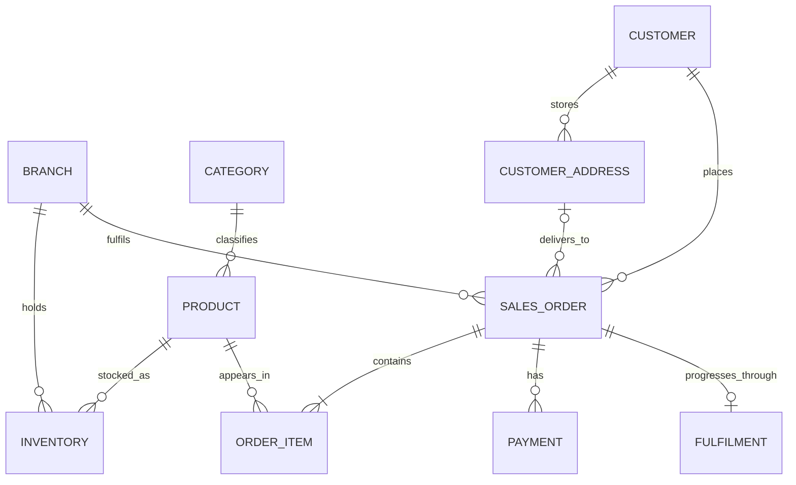

# AsterMart Entity Relationship Diagram

GitHub renders the following Mermaid diagram as a visual crow's-foot ERD. The [detailed Mermaid source](astermart-erd.mmd) also lists every modelled attribute and identifies primary, foreign, and unique keys.

## Cardinality notes

- `inventory` resolves the many-to-many relationship between branches and products.
- `order_item` resolves the many-to-many relationship between orders and products and preserves the price at purchase time.
- An order is assigned to exactly one customer and one fulfilling branch.
- A delivery address is optional from the general order perspective because pickup orders have no delivery address; a database check makes it mandatory specifically for delivery orders.
- An order may have several payment attempts but at most one fulfilment record in the current scope.
