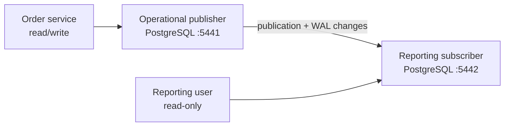

# Portfolio 5: Distributed and Cloud Database Exercise

This portfolio implements PostgreSQL logical replication from an AsterMart operational publisher to a reporting subscriber. It then evaluates replication, availability, consistency, branch-oriented distribution, and a production cloud topology.

## Local topology



Only `branch_sales_summary` is published. The subscriber receives the existing rows during initial synchronization and subsequent inserts, updates, and deletes asynchronously.

## Run the exercise

```bash
./portfolio-5-distributed-cloud/scripts/setup_and_verify_replication.sh
```

The script starts the isolated stack, creates the subscription when absent, waits for synchronization, writes a deterministic incremental summary on the publisher, and verifies that the subscriber converges to the same values. It also confirms that the reporting role cannot write.

The stack uses development-only credentials and ports 5441/5442 so it does not collide with the main PostgreSQL service on port 5433. Stop it without deleting evidence data using:

```bash
docker compose -f compose.distributed.yaml down
```

To rebuild only this disposable distributed exercise:

```bash
docker compose -f compose.distributed.yaml down -v
./portfolio-5-distributed-cloud/scripts/setup_and_verify_replication.sh
```

## Artifacts

- `postgresql/primary/`: published schema, replication role, seed rows, and publication.
- `postgresql/subscriber/`: matching target schema and read-only reporting role.
- `scripts/`: repeatable orchestration and verification.
- `evidence/`: captured replication and access-control output.
- `docs/`: distributed/cloud design, availability, consistency, and limitations.

## Verified outcome

The captured run is stored in [`evidence/replication-output.txt`](evidence/replication-output.txt). It shows:

- three pre-existing rows copied during initial synchronization;
- one subsequent `AST-ENU01` summary replicated incrementally;
- matching publisher/subscriber values;
- an active receive/apply state in `pg_stat_subscription`;
- rejection of an `INSERT` attempted by the reporting role.

[`docs/distributed-cloud-analysis.md`](docs/distributed-cloud-analysis.md) explains consistency, availability, sharding, cloud deployment, monitoring, security, and the limits of the demonstration.
